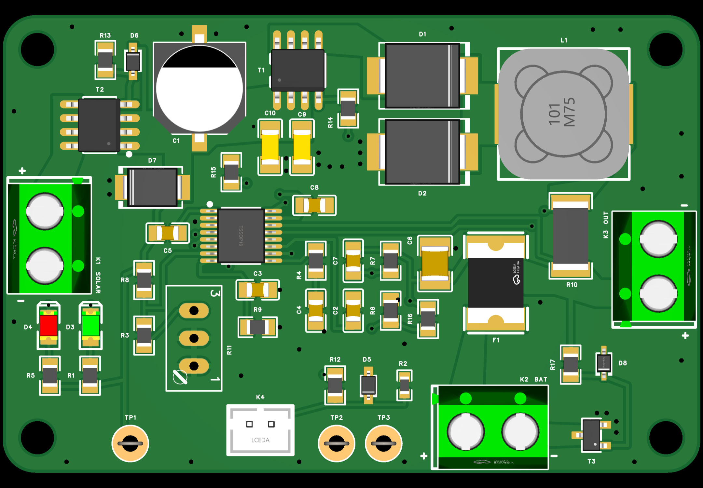
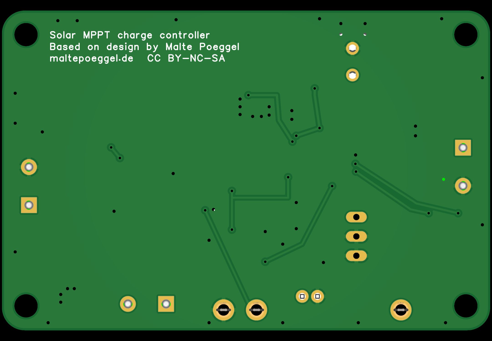

# Solar Power Module CN3722

A solar MPPT charge controller for LiIon and LiFePO4 batteries, built around the Consonance CN3722. It is a redesign of [the charger by Malte Pöggel](https://www.maltepoeggel.de/?site=solar-mppt-cn3722) and keeps every configuration option of the original. See [Differences from the original](#differences-from-the-original) for what changed and why.



*Render, not a photo. `R11` has no 3D model. `C11`, `R2`, `R15` and `R16` are not fitted.*

## Status

| Part | State |
|---|---|
| PCB | rev2, EasyEDA Pro, DRC 0 errors. Not manufactured |
| Validation | Calculated and checked in CAD only. Nothing measured |

Open items: [design record](docs/DESIGN-RECORD.md#open-items-before-ordering).

## Features

- LiIon or LiFePO4, 1S to 3S, set with `R6`, `R7` and `C7`
- Charge current 1–3 A, set with `R10`, with matching `L1` and `F1`
- MPPT voltage 8.5–27 V, set with trimmer `R11`
- Battery temperature: external NTC, on-board NTC or none
- Reverse polarity protection on the panel and battery inputs
- Screw terminals for panel, battery and load
- `TP1` and `R11` keep it compatible with the author's [FOCV tracker](https://www.maltepoeggel.de/?site=solar-mppt-focv&lang=en)

## Specifications

| Parameter | Value |
|---|---|
| Board | 64 × 42 mm, 2 layers, 1.6 mm |
| Input | 8.5 V to 26 V. Panel Voc must stay below 26 V at the coldest temperature |
| Battery | LiIon or LiFePO4, 1S to 3S, with a BMS |
| Charge current | 1 A, 2 A or 3 A by build |
| Switching frequency | 300 kHz |
| Default build | LiFePO4 2S, 7.21 V, 1 A, external NTC |
| Temperature window | About 0 °C to 50 °C with a 10 kΩ NTC |

Values for each chemistry, current and NTC mode: [`docs/SPEC.md`](docs/SPEC.md#2-build-options).



## Differences from the original

The core circuit is unchanged: CN3722, loop compensation, the MPPT divider with `R11`, status LEDs, the NTC input, and the `T1`, `D1`, `D2`, `L1`, `R10` power stage. All options from the author's article remain. The differences below were added on top of it.

### Added circuits

| Change | Parts | Why |
|---|---|---|
| Reverse protection on the panel input | `T2`, `D6`, `R13` | The original has none. Reversed panel wiring would put a negative voltage on the CN3722 supply pin |
| Surge protection on the input | `D7` | Long panel wires can pick up transients. The CN3722 and `T1` are limited to 30 V |
| Reverse protection on the battery | `T3`, `D8`, `R17` | A screw terminal is not keyed. Reversed, the battery would drive current through `D2` and put `C6` under reverse voltage |
| Ceramic input capacitors | `C9`, `C10` | Close the commutation loop right at `T1` and `D2` |
| Gate resistor position | `R14`, 0 Ω | Slows the `T1` edges if the gate rings, with no layout change |
| Input discharge resistor position | `R15`, not fitted | Suggested by the data sheet for diode leakage in sleep mode |
| Charge voltage trim position | `R16`, not fitted | Corrects the voltage on a built board. The tolerance of the CN3722 alone can exceed ±50 mV on 1S |
| Separate through-hole `C1` footprint | `C11`, not fitted | Keeps the original SMD or through-hole choice |
| More test points | `TP2`, `TP3` | Battery voltage and ground, for bench work |

### Changed parts

| Part | Original | This board | Why |
|---|---|---|---|
| `R6`, `R7`, `C7` | 48.7 kΩ, 36 kΩ, 12 pF, LiIon 1S | 101 kΩ, 200 kΩ, 4.7 pF, LiFePO4 2S | Different default build, and 0.1% resistors for accuracy. The author's table still applies, with new default values |
| `R1`, `R5` | 2.7 kΩ | 6.8 kΩ | 2.7 kΩ dissipates 0.25 W at 28 V, above the 0805 rating |
| `C6` | 10 µF tantalum | 10 µF 50 V X7R ceramic | A ceramic part is not damaged by reverse voltage, and the data sheet suggests it. 50 V matches the other ceramics |
| `T1` | SI4435 | AO4419 | Kept from the first V2 of this board. Also 30 V, in the same package |
| `F1` | 1.1 A, 1812 | 1.5 A, 2920 | More margin at 1 A, and one footprint covers every charge current up to 3 A |
| `K2` | JST XH | Screw terminal | Same connector type for panel, battery and load |
| `R11` | Vishay 64W | Bourns 3296W | The 64W was not found in the EasyEDA library. The footprint is unchanged, so the FOCV tracker still fits electrically |
| `D5` | BAT54, SOT-23 | BAT54, SOD-323 | Kept from the first V2 of this board. Same function |
| `R2` | Fitted on the board | Not fitted by default | The default build uses the external NTC, because only it measures the battery |

### Board

| Item | Original | This board | Why |
|---|---|---|---|
| Size | 60 × 34 mm | 64 × 42 mm | Room for the added parts, with at least 0.5 mm between part outlines |
| Layout | Author's layout | New layout | Power copper sized for 3 A, Kelvin connection at `R10`, GND on both layers |
| Mounting holes | 4 | 4, 57.6 × 35.6 mm apart | Moved with the larger outline |

### What this changes in use

- The input limit is about 26 V instead of 28 V, because of `D7`. A standard 36-cell panel fits. 60-cell and 72-cell panels do not.
- `T2` and `T3` add a small voltage drop, about 0.1 V in total at 3 A. It does not move the end-of-charge voltage, because the current is low at the end of charge.
- `TP1` is behind `T2`, so the FOCV tracker sees the panel voltage only with correct polarity.

## Setting the MPPT voltage

With the board powered from a bench supply and no battery, set the supply to the wanted MPPT voltage. Turn `R11` to the point between the steady red LED and the fast flicker of both LEDs.

## Ordering

Upload [`release/rev2/gerber-rev2.zip`](release/rev2) and send:

```text
5PCS, 2 LAYERS, FR4, 1.6MM, OUTER 1OZ, Green Soldermask, White Legend, Lead-free HASL, TENTED VIAS, order number will be added
```

| Item | Reason |
|---|---|
| 1 oz copper | The calculations use it. 2 oz gives more margin for 3 A in an enclosure |
| Tented vias | Vias sit close to fine-pitch pads |
| Smallest features | 0.254 mm track, 0.2 mm clearance, 0.3 mm drill |

## Bill of materials

See [`release/rev2/BOM.md`](release/rev2/BOM.md).

## Repository

| Path | Content |
|---|---|
| [`release/rev2`](release/rev2) | Ordering package: Gerber, BOM, placement |
| [`docs/SPEC.md`](docs/SPEC.md) | Requirements and build options |
| [`docs/DESIGN-RECORD.md`](docs/DESIGN-RECORD.md) | Decisions, calculations, checks, open items |
| [`docs/images`](docs/images) | Renders |

The EasyEDA Pro project `Solar Power Module CN3722 V2` is not stored here.

## License

The design is based on the work of Malte Pöggel. The author's PCB layout may be used freely for private use, but the author's name must remain on it (CC BY-NC-SA). The schematic is not subject to any restrictions. The credit is on the bottom silkscreen of this board. Keep it there in any derived version.
